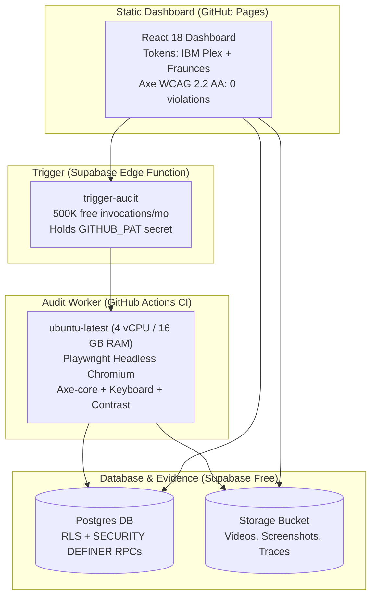

# Sunflower Accessibility Auditor

> **Autonomous agentic WCAG 2.2 AA accessibility auditor with cryptographic traceability, deterministic safeguards, and human-in-the-loop approval.**
> Team Sunflower · Ziro.Digital Agentic AI Hackathon 2026

---

## 1. Executive Overview

Traditional single-tool automated accessibility scanners miss over 60% of real WCAG barriers—such as keyboard traps in modals, unannounced custom focus outlines, and text placed over complex photograph backgrounds.

**Sunflower Accessibility Auditor** is an autonomous agent designed to:
1. **Detect what scanners miss:** Combines automated axe-core rules with an interactive Playwright keyboard walker, a true pixel-sampling contrast analyzer, and manual-assist heuristics.
2. **Retain cryptographic proof:** Every finding, decision, and action is backed by immutable evidence (video recordings, keystroke traces, dual-layer pixel samples) with SHA-256 integrity checksums.
3. **Prevent runaway actions:** Operates behind an idempotent human approval gate—no unapproved mutations occur, and accidental duplicate retries are blocked at the database level.
4. **Survive free-tier realities:** Runs 100% on verified free tiers with **zero credit card required** and graceful degradation if LLM quotas are exhausted.

---

## 2. The 4-Stage Agent Workflow

```
[1. Collect] ──> [2. Plan] ──> [3. Find] ──> [4. Act (Approval Gate)]
     │                 │              │                   │
  Input & Reachability   Declared Tool  Multi-tool Sweep &   Human Approver Signs
  Validation Gate        Execution Plan Deterministic Logic  Idempotent Action Log
```

| Stage | Implementation | Guarantees |
|---|---|---|
| **1. Collect** | `agent/src/validate.ts` | Schema validation, target level allowlist, page caps, and SSR/CSR reachability check. Invalid inputs never advance to execution. |
| **2. Plan** | `agent/src/agent/orchestrator.ts` (`planFor`) | Builds an ordered plan per page declaring the rationale for each tool (Axe, Keyboard Walk, Modal Trap Walk, Contrast Sampling, Heuristics). Stored before execution. |
| **3. Find** | `agent/src/checks/` (axe, keyboard, contrast, heuristics) | Deterministic tools extract findings. Axe provides the automated baseline; keyboard walker detects focus traps and Escape handling; sampler isolates background pixels behind text; heuristics detect generic links and missing outlines. Every result carries raw evidence and SHA-256 hashes. |
| **4. Act** | `agent/src/store/` & RPCs | All actions start as `proposed`. Execution requires explicit human approval. Idempotency keys backstopped at DB level guarantee zero duplicate issue creation. |

---

## 3. Official Test-Case Evaluation Matrix (TC1–TC4)

All four official benchmark test cases execute deterministically via `npm run official:runs`, with derivation verified by `computeMatchesExpected`:

| Test Case | Target Page | Expected Result | Actual Result | Status |
|---|---|---|---|---|
| **TC1: Focus Trap** | `demo-site/modal.html` | Modal traps keyboard focus: Issue logged with recording (WCAG 2.1.2) | Focus trapped for 3 full cycles inside modal while outer elements exist. Escape fails to close modal. Issue logged with `.webm` video recording, keystroke trace, and walk screenshots. | **PASS** (`matches_expected=true`) |
| **TC2: Automated Pass / Manual Fail** | `demo-site/links.html` | Automated tool passes but manual check fails: Still logged as failure | Axe reports **0 violations**. Manual heuristics detect **4 verified failures** (3 generic link texts under WCAG 2.4.4 and 1 removed focus indicator under WCAG 2.4.7). All 4 issues approved and logged. | **PASS** (`matches_expected=true`) |
| **TC3: Contrast on Photo** | `demo-site/photo-hero.html` | Grey text on photo background: Contrast measured on actual background | Axe reports `incomplete`. Pixel sampler captures actual photo background with text hidden (`visibility: hidden`): worst-case ratio **1.36:1** (fails 4.5:1), mean **1.51:1**. Issue logged with text-visible and background-only screenshots. | **PASS** (`matches_expected=true`) |
| **TC4: Fix Deployed & Retest** | `demo-site/form.html` &rarr; `form-fixed.html` | Fix deployed: Same page retested; issue closed only if passing | `form.html` fails label check (issue logged as open). Negative retest against broken form results in `fail` leaving issue open. Positive retest against fixed form passes, proposing `close_issue`. Issue transitions to `closed` only after recorded human approval. | **PASS** (`matches_expected=true`) |

---

## 4. Zero-Cost Free-Stack Architecture

All services operate strictly on verified free tiers with **no credit card required**:



- **Static Host:** GitHub Pages (free static hosting).
- **Trigger:** Supabase Edge Function (`trigger-audit`, 500K free calls/mo, no 15-min sleep). The hosted dashboard dispatches audits through its **New Audit** form (page URL list + target level, inline validation, Queued state while the CI worker picks up the run); the local runner starts audits via the CLI instead.
- **Audit Worker:** GitHub Actions CI (`ubuntu-latest`, 4 vCPU, 16 GB RAM, free for public repositories).
- **Database & Storage:** Supabase Free Tier (500 MB Postgres, 1 GB Storage, card-free).
- **Local Runner:** Fully self-contained local REST server and file store (`LocalStore`) writing to single `output/` root.

---

## 5. Quickstart & Local Verification

### Prerequisites
- Node.js 20 LTS or higher
- npm 10+

### Installation
```bash
# 1. Install root workspace dependencies
npm install

# 2. Install Playwright browser binary
npx playwright install chromium
```

### Complete Verification Suite
```bash
# Run full automated test suite (29/29 tests pass)
npm test

# Verify every demo fixture provokes exactly the findings its test case needs
npm run fixtures:check

# Run strict TypeScript typecheck across all workspaces (0 errors)
npm run typecheck

# Execute official benchmark test cases (TC1–TC4)
npm run official:runs

# Export complete standalone Evidence Pack (HTML + Markdown)
npm run evidence:export
```

### Reusable Verification Scripts
- `node .staging/self_audit_three_states.mjs` — WCAG 2.2 AA axe and visible-focus check across all 3 dashboard states.
- `node .staging/scan_secrets.mjs` — Scans all tracked files for leaked secrets or absolute local paths.
- `node .staging/verify-demo.mjs` — Verifies demo site accessibility fixtures.
- `node .staging/verify-fonts.mjs` — Verifies offline self-hosted fonts render with zero external requests.
- `node .staging/make-scenery.mjs` — Generates reproducible scenery photo fixture for TC3 contrast benchmark.

### Starting the Local Dashboard
```bash
# Build the web dashboard
npm run build --workspace web

# Start the local audit server & API (default port 4173)
npm run serve --workspace agent
# Open http://localhost:4173 in any browser
```

---

## 6. Adapter Architecture & Cloud Deployment

The auditor engine operates against a unified storage interface (`AuditStore` in `agent/src/store/index.ts`):
- **Local Mode (Default):** Uses `LocalStore` writing disk-isolated run records to `output/<runId>/store.json` + `evidence/`. The web dashboard connects to the local REST API (`LocalApiAdapter`).
- **Cloud Mode (GitHub Pages + Supabase):** Uses `SupabaseStore` and `SupabaseApiAdapter` talking directly to Postgres via PostgREST and Supabase Storage via native `fetch`.

To enable Cloud Mode in the dashboard:
```env
VITE_DATA_PROVIDER="supabase"
VITE_SUPABASE_URL="https://<project-ref>.supabase.co"
VITE_SUPABASE_PUBLISHABLE_KEY="<publishable-key or legacy anon key>"
```
The dashboard build receives only the public project URL and the **publishable** key (`sb_publishable_…`, or the legacy anon key). The elevated key (`sb_secret_…`, or the legacy service-role key) is used only by the audit worker via the `SUPABASE_SECRET_KEY` secret and never enters the Pages build. Per Supabase's API-keys guide (checked 2026-10-22): publishable keys are "safe to expose in browsers", secret keys "must never leave your control", and "Supabase is deprecating the `anon` and `service_role` keys by the end of 2026" — see [API keys](https://supabase.com/docs/guides/api/api-keys).

---

## 7. Model Provider Configuration & Degradation

Sunflower uses LLMs strictly for plain-language explanations, plan summaries, and assist tasks—**never for deterministic pass/fail decisions**.

Supported providers via OpenAI-compatible endpoints:
- Primary: **Groq** (`llama-3.3-70b-versatile` or `llama-3.1-8b-instant`)
- Fallback: **Google Gemini API** (`gemini-2.5-flash`)

If provider rate limits or quota errors (HTTP 429) occur, the agent retries with exponential backoff and jitter, switches to the fallback provider, and if both fail, completes the audit deterministically with `llm_status: 'quota_exhausted'`. The UI honestly renders **"Explanation unavailable"** without crashing.

`npm run official:runs` uses configured provider keys automatically, but only sends context from the synthetic public fixtures in `demo-site/`. Official decisions record `llm_status: ok` only when an explanation was returned; ordinary and keyless runs record `disabled` and do not claim AI reasoning.

## Approval security

The public anon key has read-only database access. It cannot execute `approve_action` or `execute_approved_action`. The dashboard posts the typed passcode only to the `approve-action` Edge Function; that function compares it with the `APPROVER_PASSCODE` Supabase secret and invokes the RPCs with the service role. The passcode is never saved in the browser, database, or repository.

The five-failed-attempts-per-ten-minutes throttle is in the Edge Function isolate, so a cold start resets it. It is a minimal abuse brake, not a durable rate limiter.

Supabase deployment notes (all pages checked 2026-10-22):
- Custom Edge Function secrets cannot start with `SUPABASE_` — that prefix is reserved for injected variables ([Environment variables](https://supabase.com/docs/guides/functions/secrets)).
- Edge Functions receive the elevated key via the injected `SUPABASE_SECRET_KEYS` JSON dictionary (new-style `sb_secret_` keys); the legacy `SUPABASE_SERVICE_ROLE_KEY` is kept as a fallback because it is deprecated by the end of 2026 ([API keys](https://supabase.com/docs/guides/api/api-keys)).
- Deploy with `supabase functions deploy <name>`. Per the [CLI reference for `functions deploy`](https://supabase.com/docs/reference/cli/supabase-functions-deploy), the `--no-verify-jwt` flag is documented as "Disable JWT verification for the Function." (Our functions instead set `verify_jwt: false` in their `config.json`, which the [deploy guide](https://supabase.com/docs/guides/functions/deploy) documents as per-function config.)
- Storage buckets: [Creating Buckets](https://supabase.com/docs/guides/storage/buckets/creating-buckets?language=sql&queryGroups=language).

---

## 8. Repository Structure

```
WCAG Accessibility Auditor/
├── package.json              # Workspaces: agent, web
├── prd.md                    # Product requirements & rubric mapping
├── architecture.md           # Architecture, verified free-tier registry
├── rules.md                  # Development standards & Minimal Code Policy
├── memory.md                 # Project execution log & verification records
├── .github/workflows/
│   ├── audit.yml             # GitHub Actions audit runner
│   └── deploy-pages.yml      # GitHub Pages static deployment
├── agent/                    # Core auditing agent
│   ├── src/agent/            # Orchestrator & multi-stage planning
│   ├── src/checks/           # axe, keyboard walker, contrast sampler, heuristics
│   ├── src/store/            # LocalStore & SupabaseStore implementations
│   ├── src/decide/           # Deterministic decision engine & uncertain logic
│   ├── src/server.ts         # Local REST server & static file host
│   ├── src/official_runs.ts  # TC1-TC4 runner & computeMatchesExpected
│   └── src/export.ts         # Standalone evidence pack generator
├── demo-site/                # Benchmark test fixtures (modal, links, photo-hero, form)
├── supabase/                 # Supabase Edge Functions (trigger-audit)
└── web/                      # Editorial results UI (React 18 + Vite)
```

---

## 9. License

MIT
