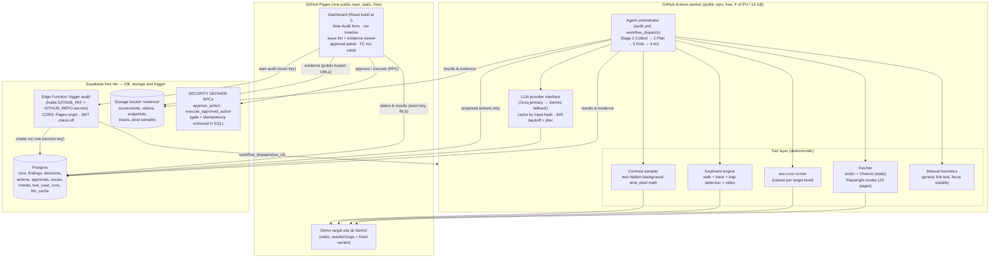

# Architecture — WCAG Accessibility Auditor (Team Sunflower)

> How we build it. Requirements live in `prd.md` (FR-01…FR-14, TC1–TC4). Standards in `rules.md`. UI system in `design.md`.
> **Zero-cost stack (verified 2026-10-17, §3):** every service is a free tier; no credit card where avoidable. The agent runs its browser work on free CI compute because no card-free always-on host can reliably run headless Chromium.

## 1. System diagram



**Retest loop:** a retest is a new audit request re-using the original page input and check params; the worker writes a `retests` row comparing observed vs intended; closing an issue happens only through `approve_action` + `execute_approved_action`.

## 2. Tech stack

| Choice | Justification (one line) |
|---|---|
| Node.js 20 LTS + TypeScript (strict) | One language across agent, server and UI; Playwright is native here. |
| GitHub Actions (public repo) as audit worker | Only card-free compute that verifiably fits headless Chromium: standard `ubuntu-latest` = 4 vCPU / **16 GB RAM**; free and unlimited for public repos. |
| GitHub Pages as static host | Free static hosting for the dashboard and the demo target from the same public repo; deploy = `git push`. |
| Supabase Edge Function (trigger) | Included free (500K invocations/mo); holds the PAT and calls `workflow_dispatch` — replaces a dedicated proxy host, so the stack is 3 services with nothing that sleeps. |
| Supabase free tier (Postgres + Storage) | Durable DB + evidence storage, card-free — free CI runners have ephemeral disks, so nothing durable may live on local disk. LocalStore adapter provides disk-isolated runs under single root output/ for local verification. |
| supabase-js (DB + Storage client) | One client for both; PostgREST means no SQL driver, and RLS + SECURITY DEFINER RPCs enforce the approval gate server-side. |
| Playwright (Chromium only) | Rendering, keyboard walking, screenshots, video; browser baked into the worker job (npm-cached), launched once per run, one page at a time. |
| axe-core (injected into the page) | Industry-standard ruleset; its "needs review" results feed our `uncertain` state. |
| undici fetch + Cheerio | Fast static retrieval path before paying Playwright's cost. |
| React 18 + Vite (dashboard) | Componentized tables/panels; static build suits Pages exactly. |
| LLM provider interface → **Groq primary, Gemini fallback** | Free tiers, env-driven model names, response cache, backoff — used only for plan summaries, explanations and classification assist (§4), never for pass/fail alone. |

Deliberately not used: ORMs, queues, Redis, microservices, Docker (CI runners need no image), always-on agent hosts (see §3 rejections), and a separate trigger proxy — Render was evaluated and removed; the Supabase Edge Function does it with fewer moving parts and no 15-minute sleep.

**Data adapter pattern & local runner:** `agent/src/server.ts` and `agent/src/store/index.ts` (`LocalStore`) implement a local server adapter writing to a single root `output/<runId>/store.json` + `evidence/` directory for offline testing, verification, and evaluation. Deployment to GitHub Pages replaces it with a Supabase client adapter (the dashboard calling Supabase Postgres queries and `approve_action`/`execute_approved_action` RPCs directly via `supabase-js` with the anon key). The dashboard's data layer in `web/` is kept behind a small interface so the deployment swap touches exactly one file. All 19 tests and the official test suite run against this unified store contract; test-case derivations are validated via `computeMatchesExpected`. Sampling is standardized at 1280x720 viewport and device scale factor 1.0.

## 3. Free-Tier Verification

All facts below were checked against the official pages on **2026-10-17**. Re-verify before submission (task P9-T7) — free tiers change.

| Service | Official source | Verified free-tier facts | Card? | Verdict |
|---|---|---|---|---|
| GitHub Actions | [billing docs](https://docs.github.com/en/billing/concepts/product-billing/github-actions), [runner specs](https://docs.github.com/en/actions/reference/runners/github-hosted-runners) | "GitHub Actions usage is free for public repositories" on standard runners; `ubuntu-latest` (public repos) = 4 vCPU, **16 GB RAM**, 14 GB SSD; larger runners always charged | No | ✅ **Audit worker** |
| GitHub Pages | [about](https://docs.github.com/en/pages/getting-started-with-github-pages/about-github-pages) | Free static hosting tied to public repos; 1 site/repo. Numeric limits (site size/bandwidth) not re-verified today — immaterial, our site < 1 MB | No | ✅ **Dashboard + demo site** |
| Supabase | [pricing](https://supabase.com/pricing) | 500 MB database, **1 GB file storage**, 5 GB egress, 2 active projects, "free projects are paused after 1 week of inactivity" | Not stated on page — confirm at signup | ✅ **DB + evidence storage** |
| Render (free web service) | [pricing](https://render.com/pricing), [docs/free](https://render.com/docs/free) | 512 MB RAM, <1 CPU, 5 GB bandwidth/mo; "spins down a Free web service that goes 15 minutes without inbound traffic", wake "about one minute"; 750 free instance-hrs/mo | No | ❌ **Removed from stack** (was the trigger proxy — superseded by the Supabase Edge Function: one fewer service, no 15-min sleep in the demo) |
| GitHub Models | [retirement notice](https://docs.github.com/en/github-models) | **"As of July 30, 2026, GitHub Models has been fully retired"** — playground, model catalog, inference API and BYOK unavailable to any customer; docs point to Azure AI Foundry (paid) | — | ❌ Rejected (retired) |
| Supabase Edge Functions | [limits](https://supabase.com/docs/guides/functions/limits), [pricing](https://supabase.com/pricing) | 500,000 invocations/mo included in the Free plan (pricing page); 256 MB memory, **2 s CPU per request** (async I/O excluded), 150 s wall clock on free, 504 after idle timeout — our trigger call uses ≈1–2 s | Not stated — confirm at signup | ✅ **Trigger** |
| Groq | [rate limits](https://console.groq.com/docs/rate-limits) | Free plan confirmed ("Free Plan Limits"); limits per model, e.g. `openai/gpt-oss-120b` = 30 RPM / 1,000 RPD / 200K TPD; models rotate — names via env only | Not stated — confirm at signup | ✅ **LLM primary** |
| Google Gemini API | [pricing](https://ai.google.dev/gemini-api/docs/pricing), [rate limits](https://ai.google.dev/gemini-api/docs/rate-limits) | Free tier exists (AI Studio key); Gemini 2.5 Flash/Flash-Lite "no charge"; exact RPM/RPD are **not published** — visible only in AI Studio; reset midnight Pacific; **free-tier content is used to improve products** | Not stated — confirm at signup | ✅ **LLM fallback** |
| OpenRouter | [limits](https://openrouter.ai/docs/api-reference/limits) | Free models: 20 RPM; **50 requests/day** without purchased credits (1,000/day needs ≥10 credits = paid) | No (free tier) | Evaluated — rejected (50/day too tight) |
| Hugging Face Spaces | [Spaces overview](https://huggingface.co/docs/hub/spaces-overview), [pricing](https://huggingface.co/pricing) | **"Gradio and Docker Spaces run on compute and require a paid plan to create: PRO"**; only Static Spaces free; CPU Basic (2 vCPU/16 GB) exists but behind paid creation | — | ❌ Rejected (no free Docker) |
| HF Inference | [pricing](https://huggingface.co/pricing) | "$2 of included inference credits monthly" is a **PRO** benefit; none found for free accounts | — | ❌ Rejected |
| Koyeb | [pricing](https://www.koyeb.com/pricing) | No free compute tier found today (free tier only for its Postgres; compute is Pro $29/mo + pay-per-use) | — | ❌ Rejected |
| Google Cloud Run | [pricing](https://cloud.google.com/run/pricing) | UNVERIFIED — page fetch failed today; historically requires a billing account (card) | Card (historical; UNVERIFIED) | ❌ Rejected |
| Cloudflare Workers | [pricing](https://developers.cloudflare.com/workers/platform/pricing/) | Free: 100,000 req/day, **10 ms CPU per invocation** | UNVERIFIED (not stated) | Evaluated — rejected (10 ms CPU; card unclear) |
| Vercel Hobby | [docs](https://vercel.com/docs/plans/hobby) | Free; 100 GB transfer, 1 M invocations, functions max **300 s**, non-commercial only | Card only for upgrades | Evaluated — not needed (the Edge Function covers the trigger) |
| Netlify | netlify.com/pricing | UNVERIFIED (not fetched) | UNVERIFIED | Evaluated — not needed |

**Why the split architecture:** HF Spaces would have been a single free host (16 GB), but Docker Spaces now require PRO; Render's 512 MB cannot hold Chromium, and its 15-minute sleep made the live demo look broken — it has been removed entirely. GitHub Models was evaluated on the team lead's request but is retired since 30 Jul 2026. Therefore: heavy browser work on GitHub Actions CI compute (verified 16 GB), the audit trigger via a Supabase Edge Function, durable state on Supabase. **Three services total**, all card-free (modulo the signup confirmations in §12).

**Chromium memory fit (worker):** documented runner RAM = 16 GB. Expected use: Node agent ≈ 150–300 MB + one headless Chromium ≈ 300–600 MB. The orchestrator processes pages **serially** (one page, one browser context at a time) and closes the browser per run, so peak stays ≈ 1 GB ≪ 16 GB. Documented fallback if a run ever OOMs: run the same CLI locally (`npm run audit -- --run <id>`) — identical code path.

## 4. Agent design — the 4-stage loop

The orchestrator (`agent/src/agent/orchestrator.ts`) executes stages **sequentially per run**, persisting state after each step so any crashed run can be inspected honestly. It runs identically locally and on CI.

| Stage | What runs | Deterministic code owns | LLM does |
|---|---|---|---|
| 1. Collect | Validate input record (URLs, level, scope limits). Assign `pg-<runId>-<nn>` IDs. | All validation; run/input rows written **before** anything executes. | Nothing. |
| 2. Plan | Build ordered check plan per page: fetch strategy → axe → keyboard walk → contrast targets → heuristics. Persist with plan ID. | Plan structure, ordering, scope guardrails (FR-13 limits). | Optional plain-language plan summary (cached). |
| 3. Find | Execute tools; every extraction stored beside its source record (URL, retrieved_at, http_status, hash). Run decision layer. | Fetching, axe, keyboard walk, pixel sampling, heuristics, all thresholds, all state transitions. | (a) plain-language issue text; (b) screenshot classification (e.g. "is a focus indicator visible?") — strict JSON, confidence < 0.8 ⇒ `uncertain`; never DB writes; never flips a deterministic fail/pass. |
| 4. Act | Compose proposed issue-log payloads → rows written with status `proposed` → dashboard shows them for approval → approved writes execute via SQL RPC (§7). | Gate state machine (in SQL), idempotency key, transaction. | Drafts payload text only (cached). |

**LLM provider interface (`agent/src/agent/llm.ts`):** one thin client, OpenAI-compatible for all providers. Provider, base URL, API key and **model name all come from env vars** — never hardcoded (free-tier model names get retired). Order: check `llm_cache` (key = sha256(model + prompt)) → call → on HTTP 429/5xx: exponential backoff (base 2 s, ×2, cap 60 s) with full jitter, max `LLM_MAX_RETRIES` (default 4) → switch to fallback provider → if both fail, continue **without** LLM: deterministic results stand, and affected decisions get `llm_status = 'quota_exhausted'`, which the UI renders as **"Explanation unavailable"** — never as a failure of the check itself. Cached responses make repeated demo runs cost zero quota.

**Decision layer (`agent/src/agent/decide.ts`):** each candidate finding becomes a `decisions` row: `{inputs, rule, reason, outcome}`. Outcomes: `fail` (deterministic check failed with complete evidence, or axe violation at target level), `pass` (same check ran and passed — recorded, not silent), `uncertain` (axe `needs review`; missing evidence artifact; element unreachable by keyboard walk; < 50 usable pixels in contrast sampling; LLM classification confidence < 0.8; page requires login/OTP/CAPTCHA → skipped per FR-13 with a suggested safe manual step).
*Contrast verdict rule:* The verdict is decided by the **worst-case (minimum) contrast ratio** sampled across the rendered element's background pixels against the text luminance (thresholds: 4.5:1 for normal text, 3:1 for large text). If any sampled region falls below the threshold, the finding fails, because text over that portion is illegible to users with low vision; the mean ratio is reported alongside for context.

## 5. Data model (Supabase Postgres, created via SQL editor; `agent/src/db/schema.sql` is the source of truth)

Same tables as before, with three changes for the new runtime: JSON columns are `JSONB`, evidence lives in Storage (`storage_path` instead of a local file path), and two additions (`llm_cache`, `decisions.llm_status`).

```sql
CREATE TABLE runs (
  run_id TEXT PRIMARY KEY,     -- 'run-20261020-1430-a1b2'
  created_at TIMESTAMPTZ NOT NULL,
  target_level TEXT NOT NULL,  -- 'WCAG2.2-AA' etc.
  status TEXT NOT NULL,        -- pending|collecting|planning|finding|awaiting_approval|done|failed
  config_json JSONB NOT NULL,
  trigger_source TEXT NOT NULL DEFAULT 'edge_function'  -- 'edge_function'|'manual_dispatch'|'local'
);

CREATE TABLE page_inputs (
  input_id TEXT PRIMARY KEY,   -- 'pg-run-20261020-1430-a1b2-01'
  run_id TEXT NOT NULL REFERENCES runs,
  url TEXT NOT NULL,
  label TEXT,
  validation_status TEXT NOT NULL,
  validation_errors JSONB
);

CREATE TABLE sources (
  source_id TEXT PRIMARY KEY,
  input_id TEXT NOT NULL REFERENCES page_inputs,
  url TEXT NOT NULL,
  retrieved_at TIMESTAMPTZ NOT NULL,
  http_status INTEGER,
  fetch_method TEXT NOT NULL,  -- 'cheerio'|'playwright'
  content_hash TEXT NOT NULL,
  snapshot_path TEXT NOT NULL  -- Storage object path
);

CREATE TABLE findings (
  finding_id TEXT PRIMARY KEY,
  run_id TEXT NOT NULL REFERENCES runs,
  input_id TEXT NOT NULL REFERENCES page_inputs,
  source_id TEXT NOT NULL REFERENCES sources,
  rule_id TEXT NOT NULL,       -- 'WCAG2.1.2' | axe rule id
  wcag_criterion TEXT NOT NULL,
  selector TEXT,
  check_type TEXT NOT NULL,    -- 'axe'|'keyboard'|'contrast'|'heuristic'
  state TEXT NOT NULL,         -- fail|pass|uncertain
  reason TEXT NOT NULL
);

CREATE TABLE evidence (
  evidence_id TEXT PRIMARY KEY,
  finding_id TEXT NOT NULL REFERENCES findings,
  type TEXT NOT NULL,          -- screenshot|video|dom_snippet|keystroke_trace|pixel_sample|axe_report
  storage_path TEXT NOT NULL,  -- Supabase Storage object
  checksum TEXT NOT NULL,
  created_at TIMESTAMPTZ NOT NULL
);

CREATE TABLE decisions (
  decision_id TEXT PRIMARY KEY,
  finding_id TEXT NOT NULL REFERENCES findings,
  outcome TEXT NOT NULL,       -- fail|pass|uncertain
  rule TEXT NOT NULL,
  reason TEXT NOT NULL,
  input_evidence_ids JSONB NOT NULL,
  llm_involved INTEGER NOT NULL DEFAULT 0,
  llm_status TEXT NOT NULL DEFAULT 'none', -- ok|quota_exhausted|disabled|none
  llm_model TEXT, llm_confidence REAL
);

CREATE TABLE actions (
  action_id TEXT PRIMARY KEY,
  idempotency_key TEXT NOT NULL UNIQUE,  -- sha256(run_id|finding_ids|action_type|payload_hash)
  action_type TEXT NOT NULL,   -- log_issue|close_issue
  status TEXT NOT NULL,        -- proposed|approved|executing|executed|failed|rejected
  payload_json JSONB NOT NULL, -- the exact approved version
  created_at TIMESTAMPTZ NOT NULL,
  executed_at TIMESTAMPTZ
);

CREATE TABLE approvals (
  approval_id TEXT PRIMARY KEY,
  action_id TEXT NOT NULL REFERENCES actions,
  decision TEXT NOT NULL,      -- approve|reject
  approver TEXT NOT NULL,
  reason TEXT,
  approved_at TIMESTAMPTZ NOT NULL
);

CREATE TABLE issues (
  issue_id TEXT PRIMARY KEY,
  finding_id TEXT NOT NULL REFERENCES findings,
  action_id TEXT NOT NULL REFERENCES actions,
  title TEXT NOT NULL,
  description TEXT NOT NULL,
  wcag_criterion TEXT NOT NULL,
  severity TEXT NOT NULL,
  status TEXT NOT NULL,        -- open|retest_pass|closed|retest_failed
  created_at TIMESTAMPTZ NOT NULL
);

CREATE TABLE retests (
  retest_id TEXT PRIMARY KEY,
  issue_id TEXT NOT NULL REFERENCES issues,
  run_id TEXT NOT NULL REFERENCES runs,
  intended TEXT NOT NULL,
  observed TEXT NOT NULL,
  outcome TEXT NOT NULL,       -- pass|fail|uncertain
  evidence_ids JSONB NOT NULL,
  created_at TIMESTAMPTZ NOT NULL
);

CREATE TABLE test_case_runs (
  tc_id TEXT PRIMARY KEY,      -- 'TC1'|'TC2'|'TC3'|'TC4'
  run_id TEXT NOT NULL REFERENCES runs,
  input_json JSONB NOT NULL,
  expected TEXT NOT NULL,
  actual TEXT NOT NULL,
  matches_expected INTEGER NOT NULL,
  explanation TEXT NOT NULL,
  evidence_paths JSONB NOT NULL
);

CREATE TABLE llm_cache (
  cache_key TEXT PRIMARY KEY,  -- sha256(model + prompt)
  model TEXT NOT NULL,
  response_json JSONB NOT NULL,
  created_at TIMESTAMPTZ NOT NULL
);
```

**Access control (minimal):** the `anon`/publishable role gets `SELECT` on the read tables plus `EXECUTE` on the two gate RPCs (§7) — everything else is secret-key only. The dashboard ships only `SUPABASE_URL` + `VITE_SUPABASE_PUBLISHABLE_KEY` (public by design, RLS-protected). The elevated key (`sb_secret_…` / legacy service-role) lives exclusively in the GitHub Actions `SUPABASE_SECRET_KEY` secret.

## 6. The four hard cases, technically

### TC1 — keyboard focus trap (FR-05)
Playwright opens the page with video recording (`browser.newContext({ recordVideo })`). The walker: press `Tab` up to `3 × (tabStopsOnPage + 5)` times; after each press, read `document.activeElement` and append `{key, timestamp, activeElementPath}` to a keystroke trace. **Trap rule (deterministic):** if a modal is open and `N` consecutive full Tab cycles never leave the modal subtree *while interactive elements exist outside it* → trap. Also record whether `Escape` closes the modal. Finding `WCAG 2.1.2`; evidence = video + keystroke trace + screenshot, all uploaded to Storage with checksums.

### TC2 — axe passes, manual fails (FR-07)
1. **Generic link text (2.4.4):** all `<a>` whose accessible name matches `["click here","read more","learn more","here","more","link"]` — axe's `link-name` rule passes these because text exists.
2. **Invisible focus (2.4.7):** walk focus to each focusable element, compare computed `outline-width/outline-color/box-shadow/background` at rest vs focused; if nothing changed *and* a zoomed screenshot region-diff is below a pixel threshold → no visible indicator.
The decision layer stores the axe report (0 violations) next to these failures so the "tool says clean / manual check fails" contrast is itself evidence.

### TC3 — contrast on a photographed background (FR-06)
1. Screenshot the element's bounding box (device pixel ratio 2) — text present.
2. Set `visibility:hidden` on the text node, screenshot again — the **actual photo pixels** behind the glyphs. Restore.
3. Foreground: 5th/95th luminance percentiles of glyph pixels (dark text → 5th, light text → 95th) to avoid anti-aliasing bias.
4. Background: sample the same region from the text-hidden shot; compute the ratio against every sampled pixel cluster; report min (worst case) and mean.
5. Thresholds 4.5:1 (3:1 for ≥24px / ≥18.66px bold). Sampling is strictly standardized at 1280x720 viewport and device scale factor 1.0 (recorded in evidence metadata) to ensure full reproducibility. Evidence: annotated screenshot, raw pixel samples, computed ratios. Fewer than 50 usable pixels ⇒ `uncertain` — never a guess.

### TC4 — retest and close-only-if-passing (FR-10)
A retest is a **new run** re-using the original page input (same URL, same check params). After Stage 3, a `retests` row records intended vs observed. Transitions: retest `pass` → `close_issue` action **proposed** and requires approval → only then `closed`; retest `fail` → issue stays `open` (`retest_failed`), old evidence preserved, new evidence attached; retest `uncertain` → stays open. There is no code or SQL path that closes an issue without both a passing retest and an approved action.

## 7. Approval gate & idempotency (enforced in Postgres)

State machine: `proposed → approved → executing → executed` (terminal), or `rejected`/`failed`. The gate is two `SECURITY DEFINER` SQL functions — the only write path the dashboard has:

1. `approve_action(action_id, decision, approver, reason)` — records the approval; `approve` moves a `proposed` action to `approved`; `reject` records the rejection. Refuses anything not in `proposed`.
2. `execute_approved_action(action_id)` — single transaction: refuses anything without status `approved` + an approval row; if the `idempotency_key` already has an `executed` action, **returns the existing result and writes nothing** (the UNIQUE constraint is the backstop against any retry race); otherwise writes the issue(s) and sets `executed`.
3. The agent (worker) writes actions only with status `proposed` — it structurally cannot execute.
4. `APPROVAL_MODE` is hard-wired `required`: the RPC refuses non-approved execution; there is no bypass flag.
5. The approval panel shows destination ("Issue log · run `run-…`") and the exact payload before approval; the approved payload is immutable — a change means a new proposal.

## 8. Demo-target plan

**Demo site** (`demo-site/`, static HTML/CSS/JS, no framework), hosted on GitHub Pages at `/demo/` of the same public repo, tagged `data-demo-bug="…"` for our own reference:

| Page | Seeded bug | Serves |
|---|---|---|
| `index.html` | Clean baseline | sanity checks, axe=0 |
| `modal.html` | Modal JS forces Tab focus to cycle inside; Escape ignored | TC1 |
| `links.html` | Axe-clean except "click here" links + custom button with `outline:none` and no substitute focus indicator | TC2 |
| `photo-hero.html` | Light-grey paragraph over a photograph | TC3 |
| `form.html` | Input with visible label text but no programmatic association (v1 broken → fixed by push) | TC4 |

TC4 procedure: audit broken `/demo/form.html` → approve issue → **`git push` the fix (Pages redeploys, same URL)** → retest → passing retest + approved close. Fallback `form-fixed.html` exists only if a mid-demo push is impossible (recorded honestly as a difference). A negative retest against the still-broken page is also recorded to show the issue stays open.

**Real public site (FR-13):** shortlist — `example.com`, one Wikipedia article, our own demo. Enforced in code: same-origin only, max 5 pages, 2 s politeness delay, robots.txt respected, one audit per demo. Blocking/login/OTP/CAPTCHA → skip, mark `uncertain`, show the safe manual step. We do not audit sites whose terms prohibit crawling.

## 9. Folder structure

```
WCAG Accessibility Auditor/
├── prd.md  architecture.md  rules.md  design.md  tasks.md  memory.md
├── package.json               # workspaces: agent, web
├── .env.example               # names only, never values
├── .github/workflows/
│   ├── audit.yml              # worker: workflow_dispatch(run_id) → agent run
│   └── deploy-pages.yml       # build web/ + copy demo-site/ → Pages (gh-pages branch)
├── agent/                     # the agent — same code locally and on CI
│   ├── src/checks/            # fetcher.ts axe.ts keyboard.ts contrast.ts heuristics.ts
│   ├── src/agent/             # orchestrator.ts planner.ts decide.ts llm.ts
│   ├── src/db/                # schema.sql queries.ts (supabase-js)
│   └── src/cli.ts             # npm run audit -- --run <id>
├── supabase/
│   └── functions/trigger-audit/  # Deno: create run row + workflow_dispatch (holds the PAT)
├── web/                       # dashboard (React + Vite → static, Pages)
├── demo-site/                 # demo target (Pages /demo)
└── tests/                     # TC1–TC4 harness + unit tests
```

## 10. Environment variables (`.env.example` — names only, never real keys)

| Var | Used by | Purpose |
|---|---|---|
| `LLM_PROVIDER` | agent | `groq` \| `gemini` \| `openrouter` |
| `LLM_BASE_URL`, `LLM_API_KEY`, `LLM_MODEL` | agent | Primary provider endpoint/key/**model name (env-driven, never hardcoded)** |
| `LLM_FALLBACK_BASE_URL`, `LLM_FALLBACK_API_KEY`, `LLM_FALLBACK_MODEL` | agent | Fallback provider |
| `LLM_MAX_RETRIES` | agent | Bounded retries before degrading (default 4) |
| `SUPABASE_URL`, `SUPABASE_SECRET_KEY` | agent, Edge Function | Server-side DB/Storage access (`sb_secret_…` new-style key; Edge Functions instead read the injected `SUPABASE_SECRET_KEYS` dict with the legacy `SUPABASE_SERVICE_ROLE_KEY` as fallback) |
| `VITE_SUPABASE_PUBLISHABLE_KEY` | web | Public-by-design read access + invoking the approval Edge Function (`sb_publishable_…` or legacy anon key) |
| `APPROVER_PASSCODE` | approve-action Edge Function | Server-side passcode for approval/execute requests; never shipped to the dashboard |
| `SUPABASE_EVIDENCE_BUCKET` | agent | Evidence bucket name (`evidence`) |
| `GITHUB_PAT`, `GITHUB_REPO` | Edge Function (Supabase secrets) | **Fine-grained PAT, this repo only, "Actions: read and write"** — the minimum that `workflow_dispatch` accepts; `owner/repo` target |
| `DEMO_SITE_URL` | agent, Edge Function | Base URL of the demo target (Pages `/demo/`); its host anchors the audit-target allowlist |
| `AUDIT_ALLOWLIST` | Edge Function, agent | Comma-separated extra allowed target hosts (e.g. `example.com,en.wikipedia.org`) — anything else is rejected at the trigger |
| `MAX_RUNS_PER_HOUR` | Edge Function | Global trigger rate limit (default 10 runs/hour, counted from the DB) |
| `MAX_PAGES_PER_RUN`, `CRAWL_DELAY_MS` | agent | Scope guardrails (FR-13); defaults 5 / 2000 |
| `APPROVAL_MODE` | all | Always `required`; other values rejected in code |

Secrets live only in: GitHub Actions secrets (worker: LLM keys, `SUPABASE_SECRET_KEY`) and Supabase secrets (Edge Function: `GITHUB_PAT`, `GITHUB_REPO`). The only values shipped to the browser are the project URL and `VITE_SUPABASE_PUBLISHABLE_KEY` (new-style `sb_publishable_…` or legacy anon key — both public by design and RLS-limited; legacy keys are deprecated by end of 2026 per supabase.com/docs/guides/api/api-keys, checked 2026-10-22).

## 11. Deployment plan

1. **One public GitHub repo** holds everything (public is required for free Actions/Pages and doubles as source evidence for judges).
2. **Dashboard + demo site → GitHub Pages:** `deploy-pages.yml` builds `web/` (Vite `base` set to the repo path) and copies `demo-site/` to a `gh-pages` branch; dashboard at `/`, demo at `/demo/`. Deploy = `git push` — which is also how TC4's fix is "deployed".
3. **Agent worker → GitHub Actions:** `audit.yml` (`workflow_dispatch`, input `run_id`): checkout → npm ci → install Chromium → `npm run audit -- --run <run_id>`. The CLI loads the existing `runs` row and its `config_json.urls` through `SupabaseStore`, then writes page inputs, findings, decisions, evidence rows/objects, actions, and the plan through that adapter.
4. **Trigger and approval → Supabase Edge Functions:** deploy `trigger-audit` and `approve-action` with JWT verification disabled; set `GITHUB_PAT`, `GITHUB_REPO`, and `APPROVER_PASSCODE` as Supabase secrets. `approve-action` is the only public approval path: it validates the passcode then calls the protected RPCs with the service role. CORS allows the Pages origin.
5. **Supabase:** schema via SQL editor; `evidence` bucket with public read (evidence contains only synthetic/public content — rules.md §Free-only); service key in secrets only.
6. **Evidence bundle:** `npm run evidence:export -- --run <id>` downloads the run's Storage objects + writes `manifest.json` (inputs, expected/actual, checksums) for the submission pack.

## 12. Risks & mitigations

**Approval throttling limitation:** `approve-action` keeps its five-failed-attempts-per-ten-minutes counter in the Edge Function isolate. It is a lightweight abuse brake, not durable protection: a cold start resets it. The passcode remains server-side and RPC grants remain revoked; use Supabase Auth or a durable rate-limit table before exposing this beyond the project dashboard.

| Risk | Mitigation |
|---|---|
| CI queue delays at demo time | Dispatch audits before they're needed; manual "Run workflow" fallback; a pre-demo throwaway audit is part of the warm-up checklist (P9-T4); "Queued on CI" state is part of the demo story. |
| Edge Function misconfig (CORS/JWT) blocks triggering | Config verified in P1-T1 and P9-T3; zero-code fallback = manual workflow_dispatch from the Actions UI. |
| Supabase project paused (1-week inactivity) | Build-window activity is daily; run one throwaway audit before the demo; if paused, restore from the dashboard (manual, 2 min). |
| LLM quota exhausted / model retired mid-demo | Cache by input hash (repeats cost zero); fallback provider; degradation to "Explanation unavailable" — deterministic checks unaffected; model switched via env only. |
| Chromium OOM on the runner | Serial page processing + browser closed per run (§3 math); local-run fallback with identical code. |
| Free tiers change before submission | Re-verify §3 table (task P9-T7); every rejected service has a documented reason and the architecture degrades gracefully. |
| Secrets in a public repo | No secrets in git, ever; `.env.example` names only; anon key is the only public value, protected by RLS + RPCs. |
| Duplicate logging on retry | Idempotency UNIQUE + transactional RPC (§7); a deliberate double-submit is part of the demo script. |
| Real site blocks or limits us | FR-13 scope limits; blocked pages become `uncertain` with a safe manual step — never bypassed. |
